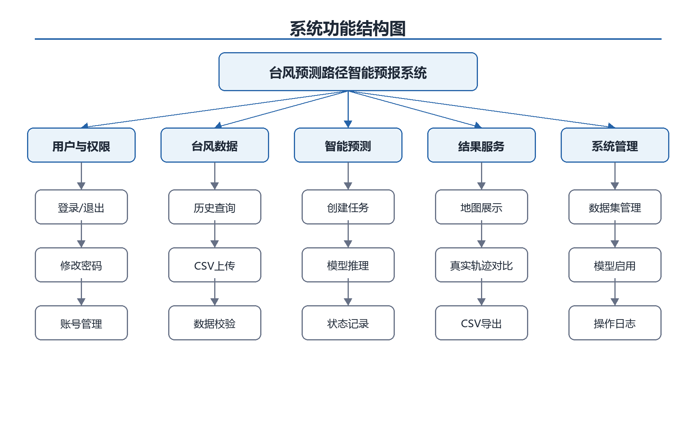
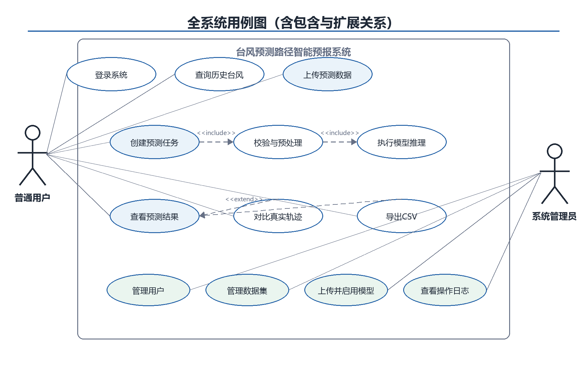
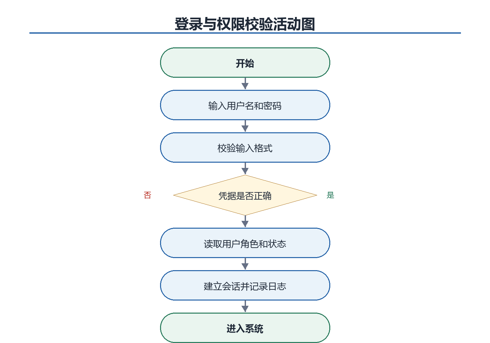
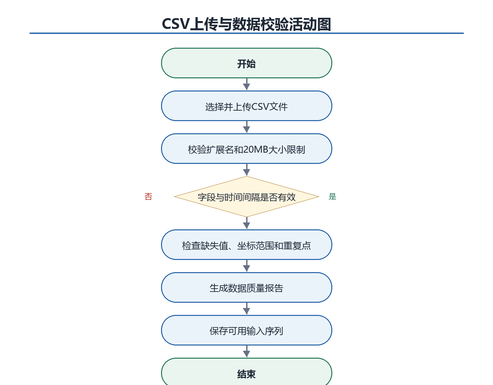
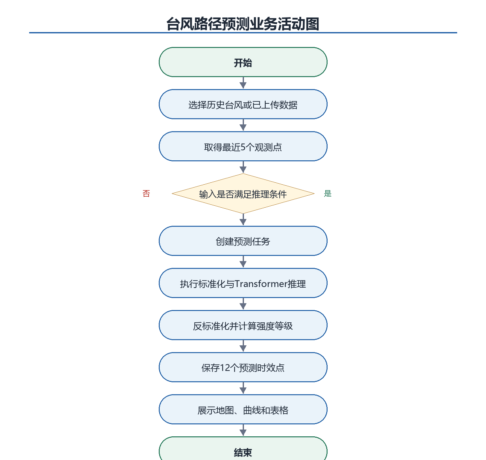

# 软件需求分析说明书

## 1 引言

### 1.1 编写目的

本文档用于明确《基于类Transformer模型的台风预测路径智能预报系统》的系统边界、功能需求、数据需求、非功能需求和验收标准，并给出概念模型及算法模型分析。文档既是后续设计、编码和测试的共同依据，也是课程阶段评审与成果验收的基线。

预期读者包括指导教师、项目组成员、系统测试人员以及后续维护人员。考虑项目组尚未接触Transformer和软件开发，本文档将目标限定为可以在课程周期内完成的教学型原型，不引入在线训练、实时气象接口、分布式任务队列等高门槛能力。

### 1.2 项目背景

台风路径预测直接关系到沿海地区防灾减灾、交通调度和应急响应。传统数值预报依赖复杂物理模型和高性能计算资源，本项目不替代业务预报，而是利用公开历史最佳路径数据，探索Transformer类时序模型对台风未来位置和强度要素的多步预测，并通过Web系统提供可视化交互。

项目由《软件工程》课程设计任务提出，开发单位为计科243课程设计小组，指导教师为刘峻。系统部署在Linux服务器或超算环境，用户通过本地浏览器和SSH端口转发访问。

### 1.3 系统范围

系统面向已注册普通用户和系统管理员。普通用户可以登录、查询西北太平洋历史台风、上传符合格式的CSV、创建预测任务、查看未来72小时路径与强度要素、与真实轨迹对比并导出CSV。管理员在普通用户能力之外管理账号、数据集、当前模型文件和操作日志。

系统明确不包含业务级气象预报发布、灾害预警决策、实时卫星数据采集、在线模型训练、模型自动调参、移动客户端以及多机构数据融合。预测结果仅用于教学研究与系统演示，界面必须标明不能作为官方防灾决策依据。

### 1.4 术语与缩写

| **术语** | **定义** |
| --- | --- |
| Transformer | 以自注意力机制处理序列依赖关系的神经网络架构。 |
| IBTrACS | International Best Track Archive for Climate Stewardship，NOAA/NCEI维护的国际热带气旋最佳路径档案。 |
| 最佳路径 | 业务机构在事后综合观测形成的台风中心位置和强度时间序列。 |
| 预测时效 | 从最后一个观测时刻起向未来计算的小时数。 |
| ADE/FDE | 平均位移误差/最终位移误差，均基于球面大圆距离。 |
| 用况 | 与用例为同一概念，描述参与者为实现目标与系统发生的交互。 |
| MVP | Minimum Viable Product，本课程周期内可演示、可验收的最小完整系统。 |

### 1.5 参考依据

- 《软件开发》任务书-计科243.docx。
- 《二、需求规格说明书.docx》课程模板。
- NOAA/NCEI, International Best Track Archive for Climate Stewardship (IBTrACS) v4。
- Vaswani A, et al. Attention Is All You Need, 2017。
- GB/T 19201-2006 热带气旋等级。

## 2 总体描述

### 2.1 建设目标

- 建立可重复的数据预处理流程，将IBTrACS西北太平洋历史资料转换为模型可用的6小时时序样本。
- 实现一个结构清晰、便于初学者理解的Transformer Encoder多步预测模型。
- 通过Web界面完成从输入、预测、查看、对比到导出的完整闭环。
- 通过需求编号、日志和验收测试保证软件工程过程可追踪。

### 2.2 参与者与权限

| **参与者** | **访问条件** | **主要权限** |
| --- | --- | --- |
| 普通用户 | 必须登录 | 查询历史台风；上传个人预测输入；创建和查看本人任务；对比与导出结果；修改本人密码。 |
| 系统管理员 | 必须登录且角色为admin | 具备普通用户能力；创建、禁用和重置用户；导入数据；上传并启用模型；查看操作日志。 |

### 2.3 运行环境与约束

| **类别** | **约束** |
| --- | --- |
| 客户端 | Chrome或Edge当前主流版本，建议分辨率不低于1366×768。 |
| 前端 | Vue 3单页应用、Leaflet；前后端分离，Flask仅提供REST API与静态资源托管。 |
| 后端 | Python 3.10及以上、Flask、Waitress（现阶段暂用的跨平台WSGI服务器，Windows开发与Linux部署通用）。 |
| 模型 | PyTorch；离线训练，Web进程只加载已训练权重推理。 |
| 存储 | SQLite保存业务数据；CSV保存或交换轨迹数据；PT保存模型权重。 |
| 部署 | Linux服务器或超算用户环境，通过SSH本地端口转发访问。 |
| 地图 | Leaflet绘制轨迹；在线底图不可用时仍须显示经纬网和轨迹。 |

### 2.4 假设与依赖

- IBTrACS数据可以从NOAA/NCEI公开渠道取得，训练数据以WP盆地为主。
- 服务器允许建立Python虚拟环境并具备模型推理所需内存；GPU不是必须条件。
- 模型训练在Web系统之外执行，训练完成后由管理员上传权重和元数据。
- 风速口径随资料机构可能不同，强度等级为教学展示结果，报告中必须注明来源与换算规则。

## 3 数据需求分析

### 3.1 数据来源与区域

主数据源确定为NOAA/NCEI维护的IBTrACS v4。训练数据选取西北太平洋WP盆地，避免只截取中国近海造成样本过少；重点展示和测试曾进入105°E-135°E、5°N-45°N范围的台风。系统保存数据来源、版本和导入时间，保证实验可复现。

### 3.2 输入与输出数据

| **数据类别** | **规模/格式** | **说明** |
| --- | --- | --- |
| 模型输入 | 最近5个观测点 | 每6小时一个点，共覆盖24小时；字段为纬度、经度、最大持续风速、最低中心气压。 |
| 模型输出 | 未来12个预测点 | 每6小时一个点，最长72小时；重点展示6/12/24/48/72小时。 |
| 派生输出 | 强度等级 | 根据预测风速按项目配置的中国热带气旋等级阈值换算。 |
| 用户文件 | CSV | UTF-8编码，表头固定，大小不超过20MB。 |
| 导出文件 | CSV | 包含任务元数据、预测时效、有效时间、经纬度、风速、气压和强度等级。 |

### 3.3 数据质量规则

| **编号** | **规则** |
| --- | --- |
| DQ-01 | 时间戳必须可解析、严格递增且相邻时间间隔为6小时。 |
| DQ-02 | 纬度范围为-90°至90°，经度统一为0°至360°或转换为-180°至180°。 |
| DQ-03 | 最大风速与最低气压必须为数值；单位统一为m/s和hPa。 |
| DQ-04 | 输入至少包含连续5个有效观测点；不足时拒绝预测并说明缺失位置。 |
| DQ-05 | 短缺失可按项目规则插值并记录质量标志，关键字段连续缺失不得进入训练或推理。 |
| DQ-06 | 训练/验证/测试按台风编号划分，禁止同一台风跨集合造成数据泄漏。 |

### 3.4 核心数据字典

| **字段** | **类型** | **含义** | **约束** |
| --- | --- | --- | --- |
| sid | 字符串 | IBTrACS台风唯一编号 | 非空 |
| iso\_time | 时间 | UTC观测时间 | 6小时间隔 |
| lat | 浮点 | 中心纬度，度 | \[-90,90\] |
| lon | 浮点 | 中心经度，度 | 统一经度口径 |
| max\_wind | 浮点 | 最大持续风速 | m/s，非负 |
| central\_pressure | 浮点 | 最低中心气压 | hPa，合理范围校验 |
| forecast\_hour | 整数 | 预测时效 | 6至72，步长6 |
| intensity\_category | 枚举 | 热带气旋强度等级 | 由风速规则计算 |
| quality\_flag | 枚举 | 原始/插值/修正标志 | 必须记录 |

## 4 功能需求

### 4.1 系统功能结构

图1 系统功能结构图

### 4.2 功能需求清单

| **编号** | **名称** | **需求说明** | **优先级** |
| --- | --- | --- | --- |
| FR-001 | 身份认证 | 系统必须校验用户名、密码、账号状态并建立会话。 | 高 |
| FR-002 | 退出与改密 | 用户可以退出登录并修改本人密码。 | 高 |
| FR-003 | 历史台风查询 | 用户可按名称、年份查询并查看实测轨迹。 | 高 |
| FR-004 | CSV上传 | 用户可上传不超过20MB的UTF-8轨迹文件。 | 高 |
| FR-005 | 数据校验 | 系统必须给出字段、时间、范围和缺失值校验结果。 | 高 |
| FR-006 | 创建预测 | 用户可选择历史台风或有效上传数据创建任务。 | 高 |
| FR-007 | 模型推理 | 系统使用当前启用模型生成未来12个时效点。 | 高 |
| FR-008 | 结果展示 | 系统以地图、表格和曲线展示轨迹、风速、气压及强度。 | 高 |
| FR-009 | 真实轨迹对比 | 存在后续实测数据时显示分时效误差。 | 中 |
| FR-010 | 任务历史 | 用户可查看本人历史任务、状态和结果。 | 中 |
| FR-011 | 结果导出 | 用户可导出标准CSV结果。 | 中 |
| FR-012 | 用户管理 | 管理员可创建、禁用和重置用户密码。 | 中 |
| FR-013 | 数据集管理 | 管理员可查看数据版本并执行受控导入。 | 中 |
| FR-014 | 模型管理 | 管理员可上传PT及元数据并将一个版本设为当前模型。 | 中 |
| FR-015 | 操作日志 | 系统记录登录、导入、模型切换和用户管理操作。 | 中 |

### 4.3 用例图和扩展用况

图2 全系统用例图（用况图）

创建预测任务包含数据校验与模型推理；真实轨迹对比和CSV导出是在查看预测结果基础上的扩展行为。管理员用例均要求admin角色，普通用户不能通过直接输入URL访问管理接口。

### 4.4 核心用例描述

### UC-01 登录系统

| **项目** | **说明** |
| --- | --- |
| 参与者 | 普通用户、系统管理员 |
| 前置条件 | 账号已由管理员创建且状态正常。 |
| 触发条件 | 用户提交用户名和密码。 |
| 基本流程 | 1. 系统检查必填项；2. 验证密码哈希；3. 读取账号状态和角色；4. 建立会话；5. 记录登录日志并进入首页 |
| 异常/扩展流程 | 凭据错误时给出统一提示；连续5次失败后锁定15分钟；禁用账号不得登录。 |
| 后置条件 | 产生有效会话，记录最后登录时间。 |
| 关联需求 | FR-001、FR-015 |

### UC-02 查询历史台风

| **项目** | **说明** |
| --- | --- |
| 参与者 | 普通用户、系统管理员 |
| 前置条件 | 用户已登录，历史数据已导入。 |
| 触发条件 | 用户输入名称或年份。 |
| 基本流程 | 1. 系统执行条件查询；2. 返回台风列表；3. 用户选择台风；4. 系统显示实测轨迹和要素曲线 |
| 异常/扩展流程 | 无匹配数据时显示空结果而非错误；部分字段缺失时显示质量标志。 |
| 后置条件 | 不修改业务数据。 |
| 关联需求 | FR-003 |

### UC-03 上传预测数据

| **项目** | **说明** |
| --- | --- |
| 参与者 | 普通用户、系统管理员 |
| 前置条件 | 用户已登录。 |
| 触发条件 | 用户选择CSV文件。 |
| 基本流程 | 1. 检查扩展名和大小；2. 解析UTF-8表头；3. 校验字段、时间和数值范围；4. 生成数据质量报告；5. 保存有效输入 |
| 异常/扩展流程 | 任何阻断性错误均拒绝保存，并按行号返回原因。 |
| 后置条件 | 形成可供预测的输入记录。 |
| 关联需求 | FR-004、FR-005 |

### UC-04 创建预测任务

| **项目** | **说明** |
| --- | --- |
| 参与者 | 普通用户、系统管理员 |
| 前置条件 | 用户已登录；存在连续5个有效观测点；当前模型可用。 |
| 触发条件 | 用户点击“开始预测”。 |
| 基本流程 | 1. 系统创建任务；2. 执行预处理；3. 调用当前Transformer模型；4. 生成12个预测点；5. 计算强度等级；6. 保存结果并返回任务编号 |
| 异常/扩展流程 | 输入不合法或模型异常时任务进入失败状态并显示可操作错误信息；用户修正后新建任务重试。 |
| 后置条件 | 任务状态为成功或失败，成功任务包含完整结果。 |
| 关联需求 | FR-006、FR-007 |

### UC-05 查看、对比与导出结果

| **项目** | **说明** |
| --- | --- |
| 参与者 | 普通用户、系统管理员 |
| 前置条件 | 用户有权访问成功任务。 |
| 触发条件 | 用户打开任务详情。 |
| 基本流程 | 1. 加载预测点；2. 绘制预测轨迹；3. 显示风速、气压和等级；4. 若有实测点则计算误差；5. 按需导出CSV |
| 异常/扩展流程 | 无实测点时隐藏误差并说明尚不可对比；导出失败时不影响页面结果。 |
| 后置条件 | 用户获得可读、可下载的预测结果。 |
| 关联需求 | FR-008、FR-009、FR-011 |

### UC-06 管理账号

| **项目** | **说明** |
| --- | --- |
| 参与者 | 系统管理员 |
| 前置条件 | 管理员已登录。 |
| 触发条件 | 管理员进入用户管理。 |
| 基本流程 | 1. 查看用户列表；2. 创建账号或修改状态；3. 必要时重置密码；4. 系统校验用户名唯一性；5. 记录审计日志 |
| 异常/扩展流程 | 管理员不得禁用当前唯一可用管理员账号。 |
| 后置条件 | 用户账号状态被持久化。 |
| 关联需求 | FR-012、FR-015 |

### UC-07 管理数据集

| **项目** | **说明** |
| --- | --- |
| 参与者 | 系统管理员 |
| 前置条件 | 管理员已登录；数据文件来源可信。 |
| 触发条件 | 管理员提交数据导入。 |
| 基本流程 | 1. 记录来源和版本；2. 解析并执行质量校验；3. 显示导入统计；4. 确认后写入数据库；5. 记录审计日志 |
| 异常/扩展流程 | 校验未通过时整批回滚，不留下半导入状态。 |
| 后置条件 | 形成可查询的数据版本。 |
| 关联需求 | FR-013、FR-015 |

### UC-08 上传并启用模型

| **项目** | **说明** |
| --- | --- |
| 参与者 | 系统管理员 |
| 前置条件 | 管理员已登录；PT文件和元数据由离线训练流程生成。 |
| 触发条件 | 管理员上传模型包。 |
| 基本流程 | 1. 检查文件类型与大小；2. 校验元数据和输入输出维度；3. 在隔离过程试加载；4. 标记为可用；5. 管理员确认后设为当前模型；6. 记录审计日志 |
| 异常/扩展流程 | 校验或试加载失败不得替换当前模型；系统始终只允许一个当前模型。 |
| 后置条件 | 新任务使用新模型，旧任务保留原模型版本号。 |
| 关联需求 | FR-014、FR-015 |

## 5 业务活动分析

### 5.1 登录活动

图3 登录与权限校验活动图

### 5.2 数据上传活动

图4 CSV上传与数据校验活动图

### 5.3 预测业务活动

图5 台风路径预测业务活动图

## 6 非功能需求

| **编号** | **类别** | **可验收要求** | **验证方式** |
| --- | --- | --- | --- |
| NFR-001 | 查询性能 | 在10名并发用户、常用查询条件下，95%的历史查询响应不超过2秒。 | 压测或计时日志 |
| NFR-002 | 推理性能 | 模型已预加载时，单条轨迹从提交到返回不超过5秒。 | 连续20次推理统计 |
| NFR-003 | 并发能力 | 至少支持10名用户同时登录、查询或提交轻量任务。 | 并发测试 |
| NFR-004 | 文件限制 | 单个CSV不超过20MB；超限在解析前拒绝。 | 边界测试 |
| NFR-005 | 预测评价 | 报告6/12/24/48/72小时大圆距离误差，24小时平均误差目标不劣于持续性预测基线。 | 独立测试集评估 |
| NFR-006 | 稳定性 | 连续运行4小时完成100次核心操作，成功率不低于99%，不得出现进程崩溃。 | 稳定性测试 |
| NFR-007 | 易用性 | 从选择数据到查看预测的主流程不超过5个主要交互步骤，错误提示包含原因和修正方法。 | 任务走查 |
| NFR-008 | 安全性 | 密码采用安全哈希；会话30分钟无操作失效；管理接口执行服务端角色校验。 | 安全测试 |
| NFR-009 | 可维护性 | 路由、业务服务、数据访问、预处理和模型推理分层，配置不得硬编码在页面。 | 代码审查 |
| NFR-010 | 可移植性 | 在Python虚拟环境中运行，不依赖root权限；SQLite与模型路径可配置。 | Linux部署验证 |
| NFR-011 | 兼容性 | 兼容Chrome和Edge当前主流版本；1366×768下关键控件不重叠。 | 浏览器与截图测试 |
| NFR-012 | 可追溯性 | 每个任务保存用户、模型版本、数据来源、创建时间和状态。 | 数据库检查 |

### 6.1 准确性说明

课程原型不承诺业务级预报精度。模型评价必须按台风划分独立测试集，使用Haversine大圆距离计算轨迹误差，分别报告各时效平均误差；风速和气压使用MAE，强度等级报告准确率。若模型未优于持续性基线，系统仍可完成软件功能验收，但报告必须如实披露模型限制和改进方向。

### 6.2 安全与隐私

- 系统不保存身份证、手机号等敏感个人信息，只保存课程账号和操作记录。
- 密码不得明文存储或写入日志；登录失败提示不得暴露账号是否存在。
- 上传文件使用随机服务器文件名，禁止路径穿越和可执行扩展名。
- 所有管理操作在服务端再次校验角色，并记录操作者、时间、动作和结果。
- 预测页面必须声明结果仅用于教学研究，不作为官方预警依据。

## 7 外部接口需求

| **方法** | **接口** | **用途** | **权限** |
| --- | --- | --- | --- |
| POST | /api/auth/login | 登录并建立会话 | 公开 |
| POST | /api/auth/logout | 退出当前会话 | 登录用户 |
| GET | /api/typhoons | 查询历史台风 | 登录用户 |
| GET | /api/typhoons/\{id\}/track | 取得实测轨迹 | 登录用户 |
| POST | /api/uploads/track | 上传并校验CSV | 登录用户 |
| POST | /api/predictions | 创建预测任务 | 登录用户 |
| GET | /api/predictions/\{id\} | 读取任务与结果 | 任务所有者/管理员 |
| GET | /api/predictions/\{id\}/export | 导出CSV | 任务所有者/管理员 |
| POST | /api/admin/users | 创建用户 | 管理员 |
| POST | /api/admin/models | 上传模型 | 管理员 |
| PUT | /api/admin/models/\{id\}/activate | 启用模型 | 管理员 |
| GET | /api/admin/logs | 查询操作日志 | 管理员 |

### 7.1 用户界面要求

- 登录页仅显示账号、密码和登录按钮，不提供开放注册入口。
- 主工作台应同时提供台风选择、输入状态、预测按钮、地图和结果摘要，核心按钮状态明确。
- 地图使用不同颜色或线型区分实测与预测轨迹，并提供图例、时间点提示和缩放。
- 表格展示所有12个预测时效点；风速、气压和强度曲线与地图选择保持一致。
- 管理页面与普通用户页面在导航中明显区分；无权限功能不显示且接口仍须拒绝。

## 8 验收与需求追踪

| **编号** | **验收场景** | **追踪需求** | **预期** |
| --- | --- | --- | --- |
| AT-01 | 使用管理员创建的普通账号登录、改密、退出。 | FR-001/002 | 通过 |
| AT-02 | 按年份和名称查询进入中国近海的历史台风并绘制轨迹。 | FR-003 | 通过 |
| AT-03 | 上传合法与非法CSV，系统分别接受或给出行级错误。 | FR-004/005 | 通过 |
| AT-04 | 用5个连续观测点生成未来12个预测点，并保存模型版本。 | FR-006/007 | 通过 |
| AT-05 | 地图、表格和曲线一致显示经纬度、风速、气压和等级。 | FR-008 | 通过 |
| AT-06 | 存在真实后续轨迹时计算分时效距离误差。 | FR-009 | 通过 |
| AT-07 | 普通用户只能查看本人任务，管理员可以查看管理日志。 | FR-010/015 | 通过 |
| AT-08 | 导出CSV字段、时效和页面显示一致。 | FR-011 | 通过 |
| AT-09 | 管理员创建/禁用账号，普通用户无法调用管理接口。 | FR-012 | 通过 |
| AT-10 | 无效模型不能替换当前模型，成功切换后新任务记录新版本。 | FR-014 | 通过 |
| AT-11 | 满足查询、推理、并发和稳定性指标。 | NFR-001~006 | 通过 |
| AT-12 | Linux虚拟环境通过Waitress启动并由SSH隧道访问。 | NFR-010 | 通过 |

## 附录A CSV输入示例

| **sid** | **iso\_time** | **lat** | **lon** | **max\_wind\_mps** | **pressure\_hpa** |
| --- | --- | --- | --- | --- | --- |
| WP202601 | 2026-07-18T00:00:00Z | 18.2 | 126.5 | 28.0 | 985 |
| WP202601 | 2026-07-18T06:00:00Z | 18.8 | 125.7 | 30.5 | 980 |
| WP202601 | 2026-07-18T12:00:00Z | 19.5 | 124.8 | 33.0 | 975 |
| WP202601 | 2026-07-18T18:00:00Z | 20.3 | 123.9 | 35.0 | 970 |
| WP202601 | 2026-07-19T00:00:00Z | 21.1 | 123.0 | 37.0 | 965 |

以上数值仅用于说明文件结构，不代表真实台风记录。正式系统必须在上传结果中显示数据来源和质量校验结论。

## 附录B 需求追踪矩阵

| **业务主题** | **需求** | **用例** | **验收** | **数据/构件** |
| --- | --- | --- | --- | --- |
| 登录与权限 | FR-001/002/012 | UC-01/06 | AT-01/09 | User、AuditLog |
| 历史数据 | FR-003/013 | UC-02/07 | AT-02 | Typhoon、TrackPoint |
| 输入校验 | FR-004/005 | UC-03 | AT-03 | DatasetImport |
| 预测任务 | FR-006/007/010 | UC-04 | AT-04/07 | PredictionTask |
| 结果服务 | FR-008/009/011 | UC-05 | AT-05/06/08 | PredictionPoint |
| 模型管理 | FR-014 | UC-08 | AT-10 | ModelVersion |
| 性能质量 | NFR-001~012 | 全部核心用例 | AT-11/12 | 日志与测试报告 |
