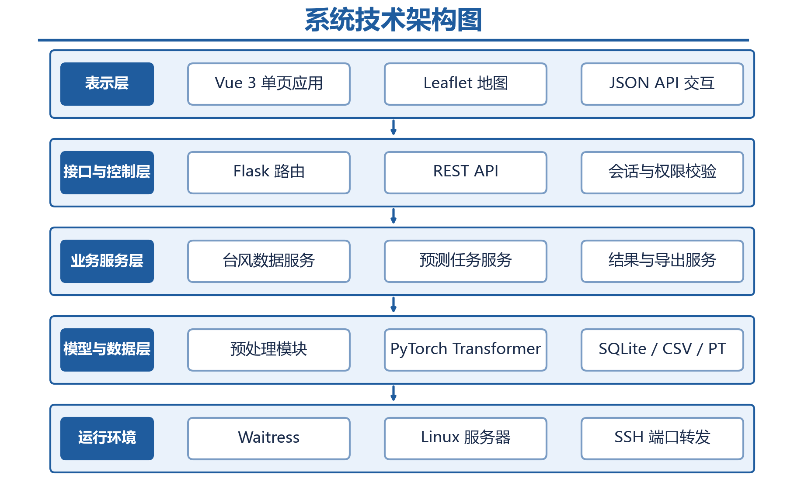
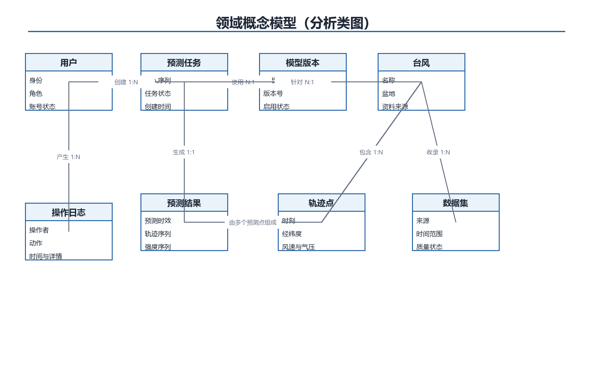
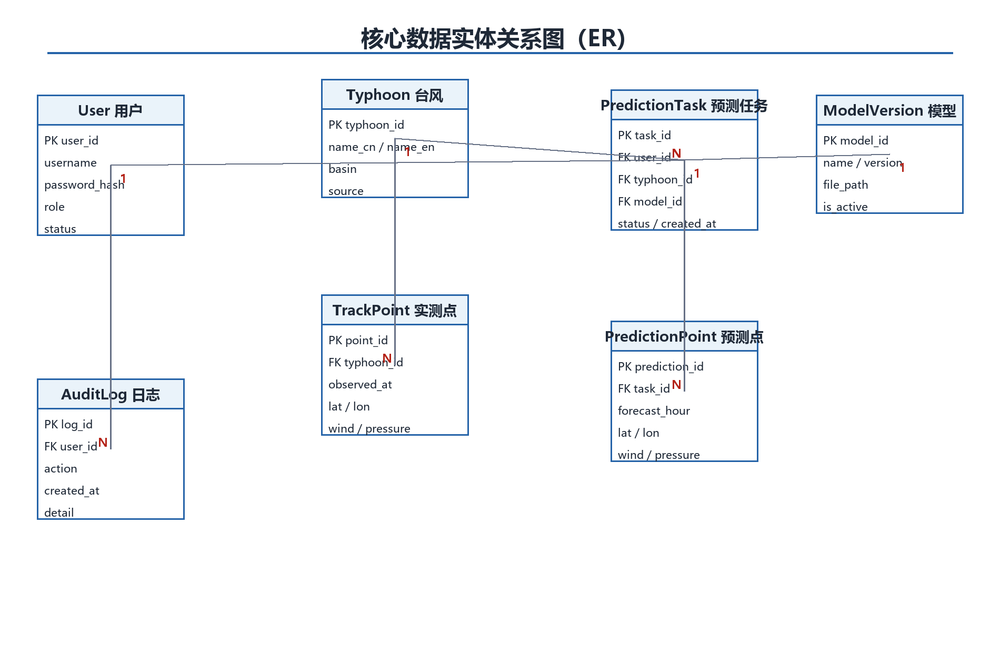
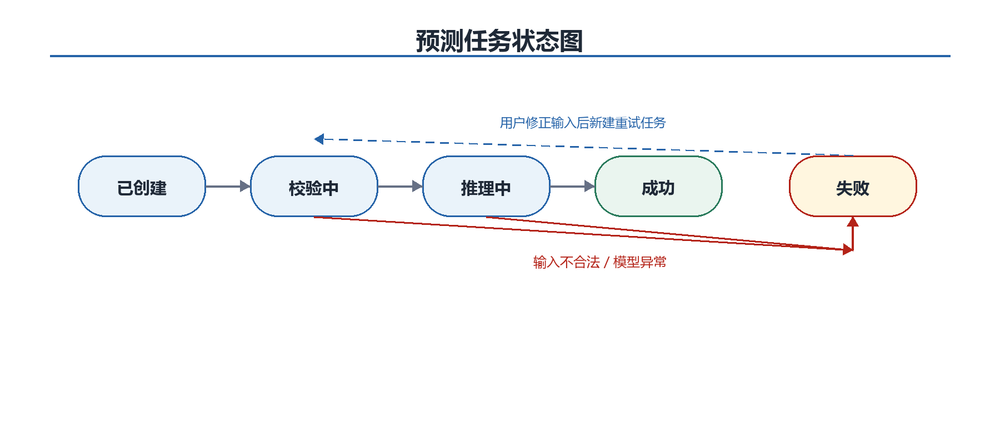
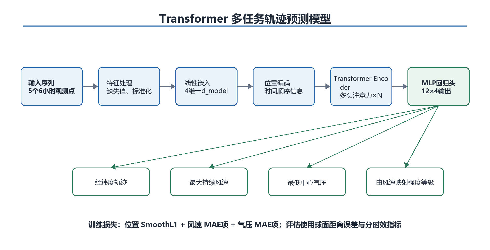
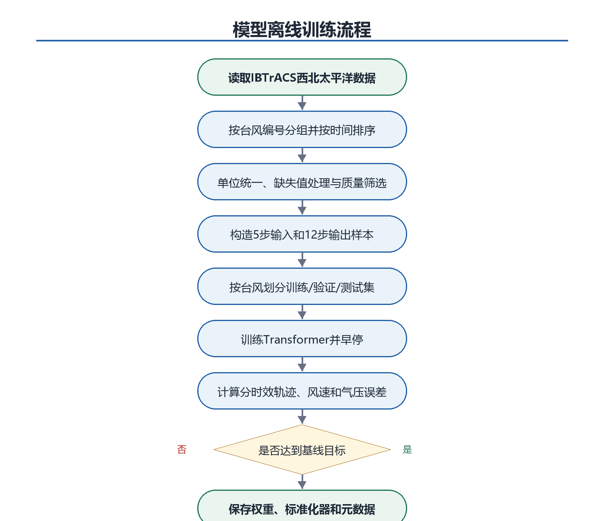
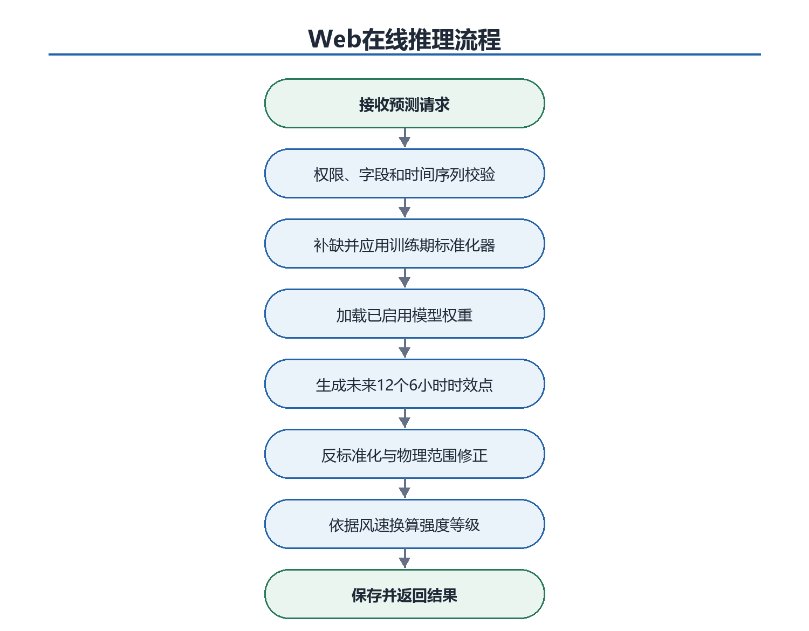
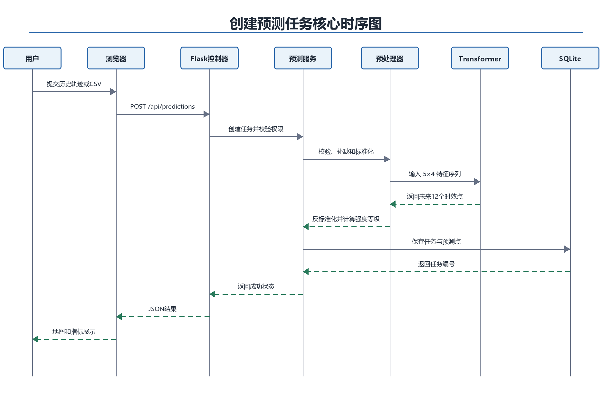

# 系统分析说明书

## 9 系统架构分析

### 9.1 总体架构

图6 系统技术架构图

系统采用单体分层架构。浏览器端基于Vue单页应用负责页面交互与轨迹绘制，通过JSON API与后端通信；Flask控制层负责会话、参数和权限；业务层编排台风查询、预测任务和结果导出；模型层封装预处理器与PyTorch推理；SQLite保存用户、任务和日志。该结构避免微服务、Redis和Celery带来的额外部署门槛，同时保留清晰模块边界。

### 9.2 部署与运行过程

- 离线训练脚本读取IBTrACS数据，输出模型权重、标准化参数和JSON元数据。
- 管理员在Web系统中上传模型包，系统试加载成功后方可启用。
- Waitress服务启动时预加载当前模型，避免每次请求重复读盘。
- Flask监听服务器本地端口；用户使用ssh -L建立本地端口转发后在浏览器访问。
- SQLite、上传目录和模型目录由配置文件指定并定期备份。

## 10 概念模型

### 10.1 领域概念类图

图7 领域概念模型（分析类图）

概念模型以预测任务为业务中心。用户创建任务，任务引用一个台风和一个已启用模型，产生一组预测点；台风由实测轨迹点构成；数据集记录台风资料来源；用户关键操作形成审计日志。模型只描述业务概念，不等同于最终代码类。

### 10.2 数据实体关系

图8 核心数据实体关系图

| **实体** | **职责** |
| --- | --- |
| User | 账号、密码哈希、角色和状态。 |
| Typhoon | 台风基本信息和资料来源。 |
| TrackPoint | 按时间排列的实测位置与强度要素。 |
| PredictionTask | 一次预测的发起者、输入、模型和状态。 |
| PredictionPoint | 某任务在一个预测时效上的输出。 |
| ModelVersion | 权重、版本、输入输出维度和启用状态。 |
| AuditLog | 需追责的用户与管理员操作记录。 |

### 10.3 预测任务生命周期

图9 预测任务状态图

任务状态仅保留已创建、校验中、推理中、成功和失败五类，避免引入消息队列后才需要的复杂排队与取消状态。失败任务保存错误摘要但不保存密码、原始异常堆栈等敏感信息；用户修正输入后创建新任务重试。

## 11 算法模型分析

### 11.1 问题定义

给定同一台风最近5个6小时观测点，构成输入矩阵X∈R^(5×4)，四个特征为纬度、经度、最大持续风速和最低中心气压。模型一次输出未来12个6小时时效点Y∈R^(12×4)。强度等级不作为独立神经网络输出，而由预测风速按等级阈值确定，从而减少模型复杂度并保证等级与风速一致。

### 11.2 模型结构

图10 Transformer多任务轨迹预测模型

| **参数** | **建议值** | **说明** |
| --- | --- | --- |
| 输入长度 | 5 | 最近24小时的5个观测时刻 |
| 输出长度 | 12 | 未来6至72小时，每6小时一个点 |
| d\_model | 64 | 入门实现的建议初值，可经验证集调整 |
| 注意力头数 | 4 | d\_model可被头数整除 |
| 编码器层数 | 2 | 控制训练时间和过拟合风险 |
| 前馈维度 | 128 | 编码器内部前馈网络 |
| Dropout | 0.1 | 训练阶段正则化 |
| 输出头 | MLP | 将编码表示映射为12×4连续值 |

这些数值是课程原型的起始配置而非业务标准。实现时先完成可以前向计算和过拟合小样本的最小模型，再逐步进行验证集调参。采用PyTorch内置TransformerEncoder可减少手写注意力机制的错误。

### 11.3 数据预处理

- 筛选BASIN=WP并按SID分组，按ISO\_TIME排序。
- 统一经纬度、风速和气压单位，去除明显越界值并保留质量标志。
- 仅对允许的短缺失执行插值；构造样本前检查连续5个输入点和12个目标点。
- 使用训练集均值和标准差标准化四个特征；验证、测试和Web推理复用同一标准化器。
- 按台风SID划分训练、验证和测试集，避免同一台风不同时间片跨集合。

### 11.4 损失函数与评价

训练损失由位置、风速和气压三部分加权组成。位置使用经纬度SmoothL1损失以降低异常值影响，风速和气压使用SmoothL1或MAE项。权重先通过量纲标准化实现平衡，再由验证集调整。模型选择以验证集综合损失为主，并同时检查轨迹是否出现超出物理范围的跳变。

| **指标** | **定义** | **用途** |
| --- | --- | --- |
| 轨迹距离误差 | Haversine大圆距离（km） | 6/12/24/48/72小时分别报告 |
| ADE | 全部预测时效平均距离 | 反映整体轨迹质量 |
| FDE | 72小时时效距离误差 | 反映远期终点偏差 |
| 风速MAE | \\|预测风速-实测风速\\|平均 | 单位m/s |
| 气压MAE | \\|预测气压-实测气压\\|平均 | 单位hPa |
| 强度准确率 | 预测等级等于实测等级的比例 | 由风速映射后计算 |

### 11.5 离线训练过程

图11 模型离线训练流程

训练过程与Web应用解耦。训练脚本必须固定随机种子、记录数据版本、特征顺序、标准化参数、模型结构和指标，并将这些元数据与PT权重一并交付。若未达到持续性基线，不得通过修改测试集或隐藏结果规避，应记录限制并优先检查数据泄漏、缺失处理和单位口径。

### 11.6 在线推理过程

图12 Web在线推理流程

Web推理只执行校验、标准化、前向计算、反标准化、物理范围修正和结果保存，不修改模型参数。模型与标准化器在进程启动或管理员切换版本时加载；若新模型试加载失败，继续使用旧模型，保证系统可用。

### 11.7 算法风险与降级策略

| **风险** | **表现** | **应对措施** |
| --- | --- | --- |
| 样本量不足 | 中国近海筛选后样本过少 | 训练使用整个WP盆地，展示与测试重点关注中国近海。 |
| 资料口径差异 | 不同机构风速平均时段不一致 | 优先使用统一字段并保留来源，等级结果标注教学用途。 |
| 长时效误差累积 | 72小时偏差明显增大 | 一次性多步输出并分时效报告，不隐藏远期误差。 |
| 初学实现错误 | 张量维度、掩码或标准化不一致 | 先做小样本过拟合测试，复用PyTorch组件和同一标准化器。 |
| 模型不可用 | 权重损坏或维度不匹配 | 上传时试加载；失败不替换当前模型。 |
| 无GPU | 训练时间较长 | 使用小模型、早停和批处理；Web推理支持CPU。 |

## 12 动态交互分析

### 12.1 核心预测时序

图13 创建预测任务核心时序图

时序图体现控制器只承担权限和参数入口，预测服务负责业务编排，预处理器和模型封装算法细节，数据库保存可追踪结果。任何层的异常都由预测服务转换为统一业务错误，不向浏览器返回服务器路径或堆栈。

## 13 可实施性与迭代边界

### 13.1 初学者实施顺序

| **阶段** | **目标** | **完成标准** |
| --- | --- | --- |
| 第1步 | 数据闭环 | 完成IBTrACS读取、筛选、可视化和CSV格式，不训练模型。 |
| 第2步 | 基线预测 | 实现持续性预测，打通任务、结果、地图与评估。 |
| 第3步 | Transformer | 使用PyTorch内置编码器替换基线，先验证张量与小样本。 |
| 第4步 | 账号与管理 | 增加登录、角色、用户管理和操作日志。 |
| 第5步 | 部署验收 | Waitress、Linux、SSH隧道、并发与稳定性测试。 |

该顺序先建立可观察的软件闭环，再加入神经网络，能将“模型没有训练好”和“Web系统有缺陷”分开定位。任何阶段都应保持主分支可运行，不应同时引入Celery、Docker编排和自定义注意力实现等超出基线的内容。

### 13.2 后续可扩展能力

在MVP稳定后，可扩展实时数据接入、更多环境场特征、概率轨迹和不确定性锥、多模型对比、在线训练任务、PostgreSQL/PostGIS及Docker部署。这些内容不属于本需求基线，不得影响本阶段验收。
